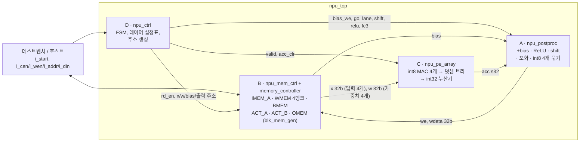

# MNIST용 INT8 MLP NPU (Verilog)

[English](README.md) | **한국어**

`start` 한 번으로 MNIST MLP(784-512-128-10) 추론 전체를 칩 안에서 끝내는 작은 NPU. int8 가중치는 전부 BRAM에 두고, 4-MAC PE 배열과 레이어 순서를 돌리는 제어기로 구성했다. Vivado 2024.2에서 AMD Kria K26(xck26-sfvc784-2LV-c), 100 MHz 기준으로 설계·검증했다.

4인 팀 프로젝트이고, 나는 제어기, 최상위 통합, 메모리 어댑터를 설계하고 검증·회귀·정확도 측정 흐름을 만들었다 ([기여 범위](#기여-범위)).

## 결과

| 항목 | 값 | 근거 |
|---|---|---|
| MNIST 테스트셋 정확도 (RTL 시뮬, 1만 장 전체) | **99.30 %** (9,930 / 10,000). 양자화 전 float 모델 99.32 % | `reports/accuracy_10k.txt`, `reports/accuracy_golden_10k.txt` |
| 비트 일치 | **1만 장 전부** FC3 점수가 파이썬 정수 골든 모델과 비트 단위로 같음. 골든 100장은 FC1/FC2/FC3 출력 전부 비트 일치 | `reports/accuracy_10k.txt`, `reports/sim_100img.txt` |
| 지연 | **장당 119,009클럭 = 100 MHz에서 1.19 ms** (초당 약 840장), 모든 이미지에서 같음 | `reports/accuracy_10k.txt` |
| PE 활용률 | **98.4 %** (119,009클럭 중 MAC 117,056클럭) | 위 클럭 수, MAC 횟수는 매 클럭 검사기가 확인 |
| 타이밍 (배선 후, 10 ns 클럭) | **WNS +2.709 ns, WHS +0.031 ns**, 실패 경로 0 / 2,165 | `reports/impl_timing_summary.rpt` |
| 자원 (배선 후) | LUT 1,183 (1.0 %) · FF 283 (0.12 %) · BRAM 112 / 144 타일 (77.8 %) · DSP 0 | `reports/impl_utilization.rpt` |
| 전력 (vectorless 추정, Confidence Low) | **0.366 W** = 동적 0.077 W (BRAM 0.038, I/O 0.025, Signals 0.006, Logic 0.004, Clocks 0.004) + 정적 0.289 W | `reports/impl_power.rpt` |

수치 형식: 입력 픽셀 0..127, 가중치는 레이어마다 스케일 하나인 대칭 int8, bias와 누산은 int32, 재양자화는 ReLU → 산술 오른쪽 shift(FC1 11, FC2 7, 버림) → 0..127 포화. FC3는 int32 점수를 그대로 내고, argmax는 테스트벤치가 계산한다.

## 구조



- **입력 방향 타일링.** 매 클럭 같은 뉴런의 입력 4개와 가중치 4개를 받아 곱 4개(s16) → 2단 덧셈 트리(s17, s18) → int32 누산기 1개. 입력 워드가 L개인 뉴런은 L클럭 (FC1 196, FC2 128, FC3 32).
- **가중치 전부 칩 안.** 가중치 117,056워드(워드당 int8 4개)는 WMEM 4뱅크에, bias 650개는 128비트 BMEM에. 모든 BRAM의 primitive 출력 레지스터를 **꺼서** 읽기 지연 1클럭 (`RD_LAT = 1`).
- **메모리 흐름 (핑퐁).** FC1은 IMEM_A를 읽어 ACT_A에 쓰고, FC2는 ACT_A → ACT_B, FC3는 ACT_B를 읽어 점수 10개를 OMEM에 쓴다. 활성값은 32비트 워드에 4개씩 묶는다.

### 뉴런 타이밍: ISSUE → WAIT → GO

```
클럭          0     1    ...   L-1    L     L+1   L+2   L+3
상태        ISSUE ISSUE  ...  ISSUE  WAIT  WAIT   GO    (다음 ISSUE)
읽기 주소    k=0   k=1   ...  k=L-1
valid → C          1     ...    1      1                     (BRAM 데이터, 1클럭 뒤)
acc (C)                                       최종값         (마지막 valid 뒤 파이프라인 2단)
go → A, acc_clr → C                                  1
we → 메모리 (A)                                            1  (FC1/FC2: 뉴런 4개마다 묶어서, FC3: 매 뉴런)
```

뉴런 하나에 **L + 3**클럭. FC1 512 × 199 + FC2 128 × 131 + FC3 10 × 35 + 3 (레이어 전환 2클럭, 마지막 쓰기 1클럭) = **119,009**클럭. 제어기 상태는 IDLE → ISSUE → WAIT → GO → (ISSUE | LAYER | DONE). `o_done`은 `o_busy`가 내려가고 마지막 OMEM 쓰기가 끝나는 같은 엣지에 올라가서, 호스트는 `o_done`을 보자마자 결과를 읽어도 된다.

## 검증

| 단계 | 검사 내용 | 결과 |
|---|---|---|
| 골든 모델 | 학습된 가중치(`.pt`)에서 파이썬 정수 모델로 다시 계산: 가중치, bias, COE 뱅크, 사진 100장 × FC1/FC2/FC3 | 33 / 33 항목 |
| 단위 TB (`tb_npu_ctrl`) | 제어 순서: GO 512/128/10, bias 쓰기 650번, 마지막 가중치 주소, 정확한 클럭 수, 매 클럭 주소 범위, 타임아웃 | PASS (RD_LAT 1, 2) |
| 통합 TB (`tb_npu_top`) | 실제 `blk_mem_gen` 시뮬 모델로 사진 100장: FC1/FC2/FC3 모든 워드, 예측, 장당 클럭 수 | 100 / 100 비트 일치 |
| 매 클럭 검사기 (`tb/review/npu_checker.v`) | TB 옆에 같이 올리는 불변 조건 15개 (주소 범위, valid/bias_we 정렬, C가 받는 가중치 = 기준값, 쓰기 순서, done/busy 규칙) | 2억 8,461만 7,352번 검사, 에러 0 (100장) |
| 합성 이미지 | 포화와 레인별 패턴을 일부러 만드는 이미지 16장 (실제 테스트셋에서는 포화가 한 번도 없음) | 16 / 16 비트 일치 |
| 예외 상황 (`tb/review/tb_edge.v`) | 12종: 연산 중 start·리셋·호스트 접근, done 직후 start, done 엣지에서 읽기 | 판정 16개 PASS, FAIL 0, 관찰 4개 |
| 버그 주입 | RTL 복사본에 버그를 하나씩 넣은 49종 | 기능 버그 42개 전부 잡음: 기존 TB가 39개, 나머지 3개는 추가한 검사기·합성 이미지·예외 TB가 잡음. 나머지 7개는 등가(3)이거나 출력이 그대로 맞음(4) |
| 독립 리뷰 | RTL, 테스트벤치, 스크립트 전체 리뷰 2회. 내 파일의 수정 사항은 회귀로 다시 확인, 남은 항목은 설계 선택지이거나 다른 블록의 결정 사항 | `docs/review_1114.md`, `docs/review_codex_1115.md` |
| 테스트셋 정확도 | MNIST 테스트셋 1만 장 전체를 RTL 시뮬 (500장 × 20묶음, 이어 돌리기 가능, RTL·IP·데이터가 바뀌면 처음부터) | 99.30 %, 파이썬 모델과 예측 차이 0장 |

`scripts/run_regress.sh` 명령 하나로 11단계 전체 회귀를 돌린다 (규칙 검사, IP 설정 검사, 골든 검사, 합성 이미지 생성, 단위 TB RD_LAT 1/2, 100장 통합 + 검사기, 합성 이미지 + 검사기, 예외 TB + 검사기, BRAM 행동 모델 RD_LAT 1/2). 하나라도 FAIL이면 exit 1. 마지막 전체 실행: 11 / 11 PASS, 368초 (`reports/regress_summary.txt`).

그 밖에: `rtl/`에 `initial`, `#delay`, `$readmem` 없음. 첫 리뷰 때 합성 후 넷리스트 시뮬(2장)과 배선 후 넷리스트 시뮬(지연 없음, 1장)이 비트 일치. 1만 장은 마지막 `o_done` 타이밍 수정 바로 전 리비전으로 돌렸고, 그 수정은 완료 신호 시점만 바꾼 것이라 회귀로 출력과 클럭 수가 같음을 확인했다.

## 실행

필요한 것: Vivado 2024.2 (xsim), Git Bash, Python 3 + numpy. 저장소 맨 위에서 실행.

```bat
scripts\run_sim.bat 10
```
`vivado_sim/` 프로젝트와 BRAM IP 10개(출력 레지스터 OFF)를 만들고 (이미 있는 프로젝트를 새로 만들려면 `fresh` 추가) 두 테스트벤치를 사진 10장으로 돌려 `result.txt`에 쓴다 (마지막 줄 `RESULT: PASS`). Vivado 경로는 .bat 맨 위 후보 목록에 추가.

```bash
bash scripts/run_regress.sh 10
```
골든 10장으로 전체 회귀 (100장은 `bash scripts/run_regress.sh`). Vivado가 `E:\Xilinx\Vivado\2024.2\bin`이 아니면 `VIVADO_BIN` 지정.

```bash
vivado -mode batch -source scripts/run_impl.tcl -log logs/run_impl.log -journal logs/run_impl.jou -notrace
```
합성 + 구현 + 사용량·타이밍·전력 리포트. WNS나 WHS가 양수가 아니면 exit 1.

테스트셋 정확도: `python scripts/gen_golden_10k.py` (`mnist.npz` 필요) → `bash scripts/run_accuracy.sh` (약 2시간 반).

## 폴더 구조

```
rtl/        합성 대상: npu_top, npu_ctrl, npu_mem_ctrl, npu_pe_array, npu_postproc, memory_controller
tb/         단위·통합 테스트벤치. tb/review: 매 클럭 검사기, 예외 상황 TB, 넷리스트 시뮬 보조
sim/        Xilinx IP 없는 시뮬레이터용 BRAM 행동 모델 (합성용 아님)
data/       coe/ BRAM 초기화, hex/ 골든 100장, ref/ 기준 가중치·단계별 값, model/ 학습된 가중치
constr/     타이밍 제약 (100 MHz 클럭)
scripts/    run_sim / run_impl / run_regress, IP 검사, 골든·정확도 도구, review/ 버그 주입·넷리스트 스크립트
docs/       설계 리뷰, 이름 규칙, 골든 모델 설명, 요구사항 체크 (한국어)
reports/    합성, 구현, 타이밍, 전력, 회귀, 정확도 결과
```

RTL 주석과 `docs/` 문서는 한국어로 되어 있다.

## 기여 범위

| 부분 | 담당 |
|---|---|
| **D · 제어기 `rtl/npu_ctrl.v`**: FSM, 레이어 설정, 단일/4뱅크 가중치 메모리 주소 생성, valid/bias/go/쓰기 정렬, done/busy 규칙 | **나** |
| **최상위 통합 `rtl/npu_top.v`**, **메모리 어댑터 `rtl/npu_mem_ctrl.v`** (메모리 블록을 수정 없이 감싸고 호스트 인터페이스, busy 기준 MUX, 읽기 지연 처리 추가) | **나** |
| **검증·도구**: `tb/`의 모든 테스트벤치, 매 클럭 검사기, 예외 상황·합성 이미지 테스트, BRAM 행동 모델, Vivado batch 흐름(`run_sim`, `run_impl`), 명령 하나 회귀, IP 설정 검사, 버그 주입, 1만 장 정확도 측정 | **나** |
| A · 후처리 `rtl/npu_postproc.v` (bias, ReLU, shift, 포화, 묶기), 골든 모델과 학습된 가중치 | 팀원 A |
| B · 메모리 블록 `rtl/memory_controller.v`, BRAM IP 설정과 COE 파일 | 팀원 B |
| C · PE 배열 `rtl/npu_pe_array.v`, 아키텍처 스펙과 이름 규칙 | 팀원 C |

팀원 파일은 받은 그대로 썼고 로직은 고치지 않았다.

## 한계와 다음 단계

- **뉴런 4개 병렬 (약 3.9배 추정).** 가중치 메모리가 이미 `뉴런 % 4`로 4뱅크에 나뉘어 있는데 지금은 클럭마다 한 뱅크만 쓴다. 4뱅크로 PE 배열 4개를 먹이면 장당 119,009 → 약 30,259클럭(3.93배), BRAM 추가 없음 (추정치, `docs/review_1114.md`. 구현 안 함).
- 가중치는 COE로 구성 시점에 들어가고, 호스트가 다시 쓰는 경로는 없다.
- 핀 배치와 I/O 지연 제약이 아직 없어서 타이밍은 레지스터 사이 경로만 본 결과이고 비트스트림은 안 만든다. SDF를 넣은 배선 후 타이밍 시뮬은 일치하지 않았다 (XSim의 SDF 처리 문제로 추정, 미해결). 타이밍 충족의 근거는 정적 타이밍 리포트.
- 8×8 곱셈기 4개가 LUT로 구현됨 (DSP 0). DSP 매핑과 가중치 BRAM enable 게이팅은 작은 후속 작업.
