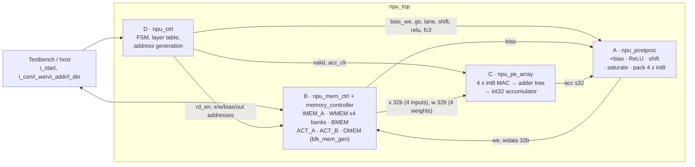

# INT8 MLP NPU for MNIST (Verilog)

**English** | [한국어](README.ko.md)

A small neural processing unit that runs a full MNIST MLP (784-512-128-10) on chip from a single `start`: int8 weights in block RAM, a 4-MAC PE array, and a layer-sequencing controller. Built and verified in Vivado 2024.2 for the AMD Kria K26 (xck26-sfvc784-2LV-c) at 100 MHz.

This was a four-person team project. I designed the controller, the top-level integration and the memory adapter, and built the verification, regression and accuracy flow ([contribution](#contribution)).

## Results

| Metric | Value | Source |
|---|---|---|
| MNIST test accuracy (RTL simulation, all 10,000 images) | **99.30 %** (9,930 / 10,000). Float model before quantization: 99.32 % | `reports/accuracy_10k.txt`, `reports/accuracy_golden_10k.txt` |
| Bit-exactness | FC3 scores of **all 10,000 images** bit-identical to the Python integer golden model. FC1/FC2/FC3 outputs bit-identical for the 100-image golden set | `reports/accuracy_10k.txt`, `reports/sim_100img.txt` |
| Latency | **119,009 cycles per image = 1.19 ms @ 100 MHz** (about 840 images/s), same count on every image | `reports/accuracy_10k.txt` |
| PE utilization | **98.4 %** (117,056 MAC cycles out of 119,009) | cycle count above, MAC count checked by the per-clock checker |
| Timing (post-route, 10 ns clock) | **WNS +2.709 ns, WHS +0.031 ns**, 0 failing endpoints out of 2,165 | `reports/impl_timing_summary.rpt` |
| Resources (post-route) | LUT 1,183 (1.0 %) · FF 283 (0.12 %) · BRAM 112 / 144 tiles (77.8 %) · DSP 0 | `reports/impl_utilization.rpt` |
| Power (vectorless estimate, confidence Low) | **0.366 W** = dynamic 0.077 W (BRAM 0.038, I/O 0.025, signals 0.006, logic 0.004, clocks 0.004) + static 0.289 W | `reports/impl_power.rpt` |

Numerics: input pixels 0..127, symmetric int8 weights with one scale per layer, int32 bias and accumulator, requantization = ReLU, arithmetic right shift (FC1 11, FC2 7, floor), saturate to 0..127. FC3 outputs raw int32 scores; the argmax is taken by the testbench.

## Architecture



- **Input-direction tiling.** Each clock the PE array takes 4 inputs and 4 weights of the same neuron: 4 products (s16) → 2-level adder tree (s17, s18) → one int32 accumulator. A neuron with L input words takes L clocks (FC1 196, FC2 128, FC3 32).
- **All weights on chip.** 117,056 weight words (4 × int8 each) in four WMEM banks, 650 biases in a 128-bit BMEM. Every BRAM has its primitive output register **off**, so the read latency is 1 clock (`RD_LAT = 1`).
- **Memory flow (ping-pong).** FC1 reads IMEM_A and writes ACT_A, FC2 reads ACT_A and writes ACT_B, FC3 reads ACT_B and writes 10 scores to OMEM. Activations are packed 4 per 32-bit word.

### Neuron timing: ISSUE → WAIT → GO

```
cycle         0     1    ...   L-1    L     L+1   L+2   L+3
state       ISSUE ISSUE  ...  ISSUE  WAIT  WAIT   GO    (next ISSUE)
read addr    k=0   k=1   ...  k=L-1
valid → C          1     ...    1      1                     (BRAM data, 1 clock later)
acc (C)                                       final          (2 pipeline stages after last valid)
go → A, acc_clr → C                                  1
we → memory (A)                                            1  (FC1/FC2: every 4th neuron, packed; FC3: every neuron)
```

One neuron costs **L + 3** clocks. FC1 512 × 199 + FC2 128 × 131 + FC3 10 × 35 + 3 (two layer-switch clocks and the final write) = **119,009** cycles. The controller states are IDLE → ISSUE → WAIT → GO → (ISSUE | LAYER | DONE). `o_done` rises on the same edge that clears `o_busy` and completes the last OMEM write, so a host can read results as soon as it sees `o_done`.

## Verification

| Layer | What it checks | Result |
|---|---|---|
| Golden model | Python integer model recomputed from the trained weights (`.pt`): weights, biases, COE banks, 100 images × FC1/FC2/FC3 | 33 / 33 checks |
| Unit TB (`tb_npu_ctrl`) | controller sequence: GO 512/128/10, 650 bias writes, last weight address, exact cycle count, address range every clock, timeout | PASS (RD_LAT 1 and 2) |
| Integration TB (`tb_npu_top`) | 100 images through real `blk_mem_gen` simulation models: every FC1/FC2/FC3 word, prediction, cycles per image | 100 / 100 bit-exact |
| Per-clock checker (`tb/review/npu_checker.v`) | 15 invariants bound next to the TB (address ranges, valid/bias_we alignment, weight seen by C equals the reference, write order, done/busy contract) | 284,617,352 checks, 0 errors (100 images) |
| Stress images | 16 synthetic images that force saturation and per-lane patterns (the real test set never saturates) | 16 / 16 bit-exact |
| Edge cases (`tb/review/tb_edge.v`) | 12 scenarios: start/reset/host access during a run, start right after done, reads on the done edge | 16 PASS, 0 FAIL, 4 observations |
| Mutation testing | 49 bugs injected one at a time into copies of the RTL | all 42 functional bugs caught: 39 by the original TBs, the other 3 only by the added checker/stress/edge tests. The remaining 7 are equivalent (3) or keep the outputs correct (4) |
| Independent reviews | two full reviews of the RTL, testbenches and scripts. Fixes in my files were re-verified with the regression; open items are design options or other blocks' decisions | `docs/review_1114.md`, `docs/review_codex_1115.md` |
| Test-set accuracy | all 10,000 MNIST test images in RTL simulation (20 chunks of 500, resumable, stamped against RTL/IP/data changes) | 99.30 %, 0 mismatches vs the Python model |

`scripts/run_regress.sh` runs the full 11-step regression with one command (rules check, IP configuration check, golden check, stress generation, unit TB at RD_LAT 1/2, 100-image integration + checker, stress + checker, edge + checker, behavioral BRAM models at RD_LAT 1/2). It exits 1 if any step fails. Last full run: 11 / 11 PASS in 368 s (`reports/regress_summary.txt`).

Also checked: no `initial`, `#delay` or `$readmem` in `rtl/`. During the first review, post-synthesis netlist simulation (2 images) and post-route netlist simulation without delays (1 image) were bit-exact. The 10,000-image run used the revision just before the final `o_done` timing change; that change moves only the done flag, and the regression confirms identical outputs and cycle counts.

## Run it

Requires Vivado 2024.2 (xsim), Git Bash and Python 3 with numpy. Run from the repository root.

```bat
scripts\run_sim.bat 10
```
Creates `vivado_sim/` with the 10 BRAM IPs (output register off; add `fresh` to rebuild an existing project), runs both testbenches on 10 images and writes `result.txt` (last line `RESULT: PASS`). Edit the Vivado path list at the top of the .bat if needed.

```bash
bash scripts/run_regress.sh 10
```
Full regression with 10 golden images (`bash scripts/run_regress.sh` for 100). Set `VIVADO_BIN` if Vivado is not in `E:\Xilinx\Vivado\2024.2\bin`.

```bash
vivado -mode batch -source scripts/run_impl.tcl -log logs/run_impl.log -journal logs/run_impl.jou -notrace
```
Synthesis + implementation + utilization/timing/power reports. Exits 1 if WNS or WHS is not positive.

Test-set accuracy: `python scripts/gen_golden_10k.py` (needs `mnist.npz`), then `bash scripts/run_accuracy.sh` (about 2.5 hours).

## Repository layout

```
rtl/        synthesizable RTL: npu_top, npu_ctrl, npu_mem_ctrl, npu_pe_array, npu_postproc, memory_controller
tb/         unit and integration testbenches; tb/review: per-clock checker, edge-case TB, gate-level helpers
sim/        behavioral BRAM model for simulators without Xilinx IP (not for synthesis)
data/       coe/ BRAM init files, hex/ 100-image golden set, ref/ reference weights and per-stage values, model/ trained weights
constr/     timing constraint (100 MHz clock)
scripts/    run_sim / run_impl / run_regress, IP check, golden and accuracy tools, review/ mutation and netlist scripts
docs/       design reviews, naming rules, golden model notes, requirements check (Korean)
reports/    synthesis, implementation, timing, power, regression and accuracy results
```

RTL comments and the documents in `docs/` are written in Korean.

## Contribution

| Part | Owner |
|---|---|
| **D · controller `rtl/npu_ctrl.v`**: FSM, layer configuration, address generation for single and 4-bank weight memory, valid/bias/go/write alignment, done/busy contract | **me** |
| **Top-level integration `rtl/npu_top.v`** and **memory adapter `rtl/npu_mem_ctrl.v`** (wraps the memory block unchanged, adds the host interface, busy-based muxing and read-latency handling) | **me** |
| **Verification and tooling**: all testbenches in `tb/`, the per-clock checker, edge-case and stress tests, behavioral BRAM model, Vivado batch flows (`run_sim`, `run_impl`), the one-command regression, IP configuration check, mutation testing, 10,000-image accuracy flow | **me** |
| A · post-processing `rtl/npu_postproc.v` (bias, ReLU, shift, saturation, packing); golden model and trained weights | team member A |
| B · memory block `rtl/memory_controller.v`, BRAM IP configuration and COE files | team member B |
| C · PE array `rtl/npu_pe_array.v`; architecture spec and naming rules | team member C |

The team members' files are used as delivered; I did not change their logic.

## Limitations and next steps

- **4 neurons in parallel (estimated ~3.9×).** The weight memory is already split into 4 banks by `neuron % 4`, but only one bank is used per clock. Feeding four PE arrays from the four banks would cut a frame from 119,009 to about 30,259 cycles (3.93×) with no extra BRAM (estimate in `docs/review_1114.md`, not implemented).
- Weights are loaded from COE at configuration time; there is no host path to rewrite them.
- No pin assignment or I/O delay constraints yet, so timing covers register-to-register paths only and no bitstream is generated. The post-route timing simulation with SDF did not match (suspected XSim SDF handling, unresolved); timing closure is based on the static timing reports.
- The four 8×8 multipliers map to LUTs (DSP 0); mapping them to DSPs and gating the weight-BRAM enables are small follow-ups.
